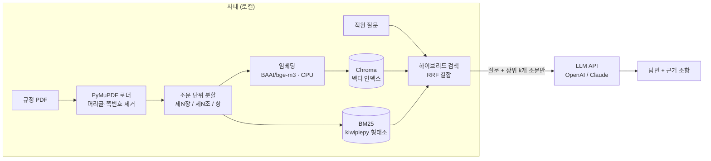

# 사내 규정 RAG 챗봇

> 직원이 사내 규정을 자연어로 질문하면, 관련 조문을 검색해 **근거 조항과 함께** 답변하는 RAG(Retrieval-Augmented Generation) 챗봇
> **상태:** 진행 중 — 기술 검토 · 아키텍처 설계 · 프로젝트 기반(설정/모델 계층) 구축 완료, 문서 처리 파이프라인 착수 예정

| 항목 | 내용 |
|---|---|
| 역할 | 개인 프로젝트 (기획 · 설계 · 개발) |
| 기간 | 2026.10 ~ 진행 중 |
| 언어 / 패키지 관리 | Python 3.13 · Poetry 2 |
| 핵심 기술 | LangChain 1.x · HuggingFace(bge-m3) · Chroma · BM25(kiwipiepy) · OpenAI / Anthropic API · Gradio |

---

## 1. 배경과 문제 정의

- 사내 규정(복무 · 휴가 · 경비 등)은 PDF로 흩어져 있어, 직원이 필요한 조항을 찾기 어렵고 담당 부서에 같은 문의가 반복된다.
- 일반 LLM에 바로 물으면 **회사 규정이 아닌 일반론이나 지어낸 답(환각)** 을 내놓는다.
- 규정은 사내 문서이므로 **외부 전송 범위를 통제**해야 한다.

**목표**
1. 규정 문서에 근거한 답변만 생성하고, 답변마다 **출처 조항(규정명 · 제N조)** 을 표시한다.
2. 규정 원문 전체는 사내(로컬)에서만 처리하고, 외부 API로는 **질문 + 검색된 조문 몇 개만** 보낸다.
3. 규정 개정 시 **해당 문서만 교체**할 수 있는 운영 구조를 만든다.

---

## 2. 사전 학습 — LangChain RAG 6단계

본 프로젝트에 앞서 LangChain 강의(6개 섹션)와 실습 노트북으로 RAG 전 과정을 학습했다.

| 섹션 | 학습 내용 | 프로젝트 적용 |
|---|---|---|
| 1. RAG 기초 | Loader · Splitter · Embedding · VectorStore · Retriever · LLM | 전체 파이프라인 뼈대 |
| 2. LCEL | `prompt \| llm \| parser`, Runnable(Parallel · Passthrough · Lambda), stream | 체인 구성 방식 |
| 3. 데이터 처리 · 임베딩 | 정규식 · 토큰 · 의미 기반 분할, OpenAI / HF / Ollama 임베딩 비교 | 조문 단위 분할, 임베딩 선정 |
| 4. 벡터스토어 · 검색 평가 | Chroma / FAISS, BM25, Hybrid(EnsembleRetriever, RRF), Hit Rate · MRR · NDCG | 하이브리드 검색, 정량 평가 기준 |
| 5. 고급 검색 | MultiQuery, Decomposition, CrossEncoder Re-rank, Contextual Compression | 검색 정확도 고도화 후보 |
| 6. 생성 · 평가 | LLM 공급자 비교, ROUGE · Embedding distance, LLM-as-judge | 모델 비교 · 답변 품질 평가 |

---

## 3. 아키텍처



**데이터 흐름의 핵심:** 문서 전체를 다루는 단계(로딩 · 분할 · 임베딩 · 인덱싱 · 검색)는 모두 로컬에서 수행하고, 외부 API에는 답변 생성에 필요한 최소 정보만 전달한다.

---

## 4. 주요 기술 의사결정

### 4-1. 실행 구성: "임베딩은 로컬, 생성만 API" (혼합 구성)

| 후보 | 외부 전송 | GPU 없이 운영 | 판단 |
|---|---|---|---|
| A. 전부 로컬 (bge-m3 + Ollama) | 없음 | ✕ 답변당 수십 초 | 제외 |
| **B. 혼합 (bge-m3 + LLM API)** | 질문 + 조문 일부 | ○ | **채택** |
| C. 전부 외부 (OpenAI 임베딩 + LLM) | 규정 전체 | ○ | 제외 |

- **제약 조건 2개를 동시에 만족하는 유일한 구성:** ① 규정 전체를 외부로 보내지 않는다, ② GPU가 없는 환경에서 운영한다.
- 임베딩은 인덱싱 시 1회(개정 시 재실행) + 질문 1건씩이라 **CPU로 충분**하고, 연산이 무거운 생성만 API로 분리했다.
- 외부 전송 최소화: LLM에는 상위 `k`(3~5)개 조문만 전달, 파일 경로 등 불필요한 메타데이터는 프롬프트에서 제외.

### 4-2. 임베딩 모델: `BAAI/bge-m3`

| 모델 | 한국어 | 최대 입력 | 실행 | 비고 |
|---|---|---|---|---|
| **BAAI/bge-m3** | 우수 | 8,192 토큰 | 로컬 | **채택** |
| multilingual-e5-large | 우수 | 512 토큰 | 로컬 | 평가 단계 비교 후보 |
| ko-sroberta-multitask | 양호 | 128 토큰 | 로컬 | 긴 조문이 잘림 |
| text-embedding-3-small | 우수 | 8,191 토큰 | API | 문서 전체 외부 전송 |
| nomic-embed-text | 미흡 | 8,192 토큰 | 로컬 | 한국어 검색 품질 낮음 |

- 항이 많은 긴 조문도 **잘리지 않는 입력 길이**, 로컬 실행, 한국어 성능을 기준으로 선정.
- 임베딩 모델을 바꾸면 인덱스 전체를 재생성해야 하므로, **어떤 LLM 구성에서도 공통으로 쓸 수 있는 모델**로 먼저 고정했다.
- 최종 확정은 평가셋(QA 50~100쌍) 기반 Hit Rate · MRR 비교 후 진행.

### 4-3. LLM: OpenAI + Anthropic 이중 지원, 설정으로 전환

- 검색 계층은 공통으로 두고 **생성 LLM만 교체 가능한 구조** → 동일한 검색 결과로 두 모델을 공정하게 비교할 수 있다.
- 모델은 **날짜가 고정된 스냅샷 ID**(예: `gpt-5.4-mini-2026-03-17`)를 사용 → 공급사의 별칭 업데이트로 답변 품질이 예고 없이 바뀌는 것을 방지하고, 평가 결과의 재현성을 확보.

### 4-4. 문서 처리 · 저장 · 검색

| 영역 | 선택 | 근거 |
|---|---|---|
| PDF 로더 | **PyMuPDF** | 학습 중 pypdf로 한글 PDF를 추출하자 띄어쓰기가 전부 사라지는 현상 확인 → BM25 키워드 검색과 정규식 분할에 직접 영향 |
| 분할 | **정규식 조문 단위** (제N장 / 제N조 / 항) | 조문이 중간에 잘리지 않아 근거 인용이 정확, 조 번호를 메타데이터로 추출 |
| 벡터 저장소 | **Chroma** | 규정 규모(수천 청크)에 충분, 개정 시 문서 단위 삭제·추가와 메타데이터 필터가 용이 (FAISS는 변경·필터가 불리) |
| 검색 | **하이브리드 (BM25 + 벡터, RRF)** | 규정은 "경조금", "제12조" 같은 정확한 용어가 많아 키워드 검색이 필요하고, "휴가 쓰려면?" 같은 구어체 질문은 의미 검색이 필요 |
| 라이브러리 | LangChain 1.x, 독립 통합 패키지 사용 | `langchain-community`가 유지보수 종료(sunset) 단계임을 확인 → 신규 코드에서는 의존을 최소화 |

---

## 5. 구현 내용 (현재까지)

### 프로젝트 구조

```
regulation-chatbot/
├─ src/regbot/
│   ├─ config.py      # .env → 불변 Settings 객체
│   └─ models.py      # get_embeddings(), get_llm() 팩토리
├─ scripts/
│   └─ check_setup.py # 설정 · 임베딩 · LLM 연결 점검
├─ data/raw/          # 규정 PDF (git 제외)
├─ docs/              # 기술 검토 · 의사결정 문서
├─ .env.example       # 설정 템플릿 (비밀 값 없음)
└─ pyproject.toml     # Poetry 2 (PEP 621)
```

### 설정 계층 — 환경 변수 기반, 코드 변경 없이 구성 전환

```python
@dataclass(frozen=True)
class Settings:
    llm_provider: str            # openai | anthropic
    openai_model: str
    anthropic_model: str
    llm_temperature: float | None
    embedding_model: str         # 로컬 경로도 허용 (사내망 다운로드 차단 대비)
    embedding_device: str
    docs_dir: Path
    chroma_dir: Path
    chroma_collection: str
    retriever_k: int             # LLM에 전달할 조문 수 = 외부 전송량
```

- `.env` 값만 바꿔 LLM 공급자 · 모델 · 검색 개수를 전환 (12-Factor App의 설정 분리 원칙).
- `frozen=True`로 런타임 중 설정 변경을 막고, 상대 경로는 프로젝트 루트 기준으로 정규화.

### 모델 팩토리 — 공급자 추상화

```python
def get_llm(provider: str | None = None) -> BaseChatModel:
    provider = (provider or settings.llm_provider).lower()

    kwargs = {}
    if settings.llm_temperature is not None:   # 일부 최신 모델은 temperature 미지원
        kwargs["temperature"] = settings.llm_temperature

    if provider == "openai":
        if not settings.openai_model:
            raise ValueError(".env 의 OPENAI_MODEL 이 비어 있습니다.")
        return ChatOpenAI(model=settings.openai_model, **kwargs)
    if provider == "anthropic":
        return ChatAnthropic(model=settings.anthropic_model, max_tokens=1024, **kwargs)
    raise ValueError(f"지원하지 않는 LLM_PROVIDER: {provider!r}")
```

- 호출부는 `BaseChatModel` 인터페이스에만 의존 → 공급자 추가(예: 향후 GPU 서버의 로컬 LLM) 시 분기 하나만 추가.
- 임베딩 모델은 `lru_cache`로 프로세스당 1회만 로드(약 2GB), `normalize_embeddings=True`로 내적 = 코사인 유사도.
- 설정 누락은 실행 초기에 **명확한 메시지로 실패(fail-fast)**.

### 환경 점검 스크립트

```
[1] 설정값        API 키는 값 대신 "설정됨/없음"만 출력
[2] 임베딩        "연차휴가 신청" ↔ "휴가 쓰려면" 유사도 > "연차휴가" ↔ "법인카드" 인지 확인
[3] LLM API 연결  공급자별 호출 성공 여부 (키 없는 공급자는 건너뜀)
```
- `--skip-llm` 옵션으로 API 비용 없이 로컬 구성만 점검 가능.

### 보안 · 운영 고려

- API 키는 `.env`에만 저장, `.env` · 규정 원본(`data/raw/`) · 벡터 인덱스(`data/chroma/`)는 `.gitignore`로 저장소에서 제외 (`git check-ignore`로 검증).
- 개발 · 테스트는 **가상의 규정 샘플**로만 진행하고, 실제 규정 투입은 검증 환경에서 담당자가 수행하는 원칙 수립.
- 의존성 버전은 PyPI 최신 버전과 Python 3.13 wheel 제공 여부를 확인 후 범위 지정, `poetry.lock`으로 고정.

---

## 6. 로드맵

| Phase | 내용 | 상태 |
|---|---|---|
| 0 | 요구사항 · 보안 제약 정리, 구성 비교 · 선정 | ✅ 완료 |
| — | 프로젝트 셋업 (설정 계층, 모델 팩토리, 점검 스크립트) | ✅ 완료 |
| 1 | PDF 로딩 · 조문 단위 분할 · 메타데이터 설계 | ⏳ 다음 단계 |
| 2 | Chroma 인덱싱 + 하이브리드 검색 + LCEL RAG 체인 | 예정 |
| 3 | 평가셋 구축(LLM 합성 + 담당자 검수), 검색 지표(Hit Rate · MRR · NDCG) 측정 | 예정 |
| 4 | Re-rank(bge-reranker-v2-m3) · MultiQuery 등 고도화 — 지표 개선 시에만 채택 | 예정 |
| 5 | OpenAI vs Claude 답변 품질 비교 (LLM-as-judge, 환각 검사) | 예정 |
| 6 | Gradio UI(스트리밍 · 출처 표시) · 사내 배포 · 접근 제어 | 예정 |
| 7 | 규정 개정 재인덱싱 절차, 피드백 기반 평가셋 확장 | 예정 |

**설계 원칙:** "측정 → 개선 → 재측정". 고급 검색 기법은 도입 비용(지연 시간 · API 비용)이 있으므로, 평가 지표가 실제로 개선될 때만 채택한다.

---

## 7. 배운 점

- **제약 조건이 아키텍처를 결정한다.** 보안(외부 전송 범위)과 하드웨어(GPU 없음)라는 두 제약을 표로 놓고 비교하니 선택지가 하나로 좁혀졌다. 기술 선택을 "좋아 보이는 것"이 아니라 제약과 근거로 설명할 수 있게 됐다.
- **도구의 기본값을 의심하기.** 강의에서 쓰던 pypdf가 한글 PDF의 띄어쓰기를 잃는 것을 직접 확인했고, 이것이 검색 품질 전체에 영향을 준다는 점을 알게 됐다.
- **재현성은 평가의 전제.** LLM 모델 ID를 스냅샷으로 고정하고, 임베딩 모델을 먼저 고정한 이유는 이후 비교 실험의 결과를 신뢰하기 위해서다.
- **생태계 변화 추적.** 학습 환경(LangChain 0.2)과 현재 버전(1.x) 사이의 패키지 구조 변화와 `langchain-community` 유지보수 종료를 확인하고 신규 프로젝트 의존성을 다시 설계했다.
