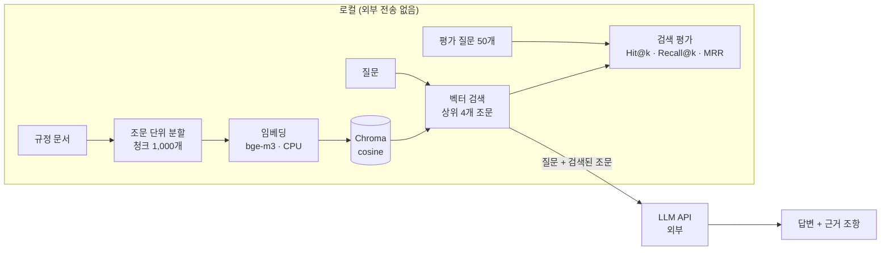

# 포트폴리오 반영 초안 (2026-10-29 작업분)

| 항목 | 내용 |
|---|---|
| 용도 | 오늘 한 RAG 챗봇 작업을 기존 Notion 포트폴리오에 반영할 문안 초안 |
| 반영 방법 | Codex가 기존 페이지 구조와 맞춰 검토하고, 담당자 승인 뒤에 반영한다. 이 초안을 쓸 때 Notion 페이지는 열거나 수정하지 않았다 |
| 근거 기록 | [검색_구축과_평가.md](검색_구축과_평가.md), [검색_튜닝_실험기록.md](검색_튜닝_실험기록.md) |
| 현재 상태 | **기준선 측정 및 튜닝 준비.** 튜닝을 적용한 개선 결과는 아직 없다 |
| 보안 | 규정 원문, 규정명, 파일명, 평가 질문 문장은 넣지 않았다. 수치와 개수만 쓴다 |

> 반영할 때 주의: 이 문서에 없는 성과나 수치를 덧붙이지 않는다. 6장 "확인이 더 필요한 사항"이 정리되기 전에는 해당 표현을 확정하지 않는다.

---

## 1. 반영 위치 제안

Notion 페이지를 직접 보지 않고 쓴 제안이다. 실제 섹션 이름은 Codex가 기존 페이지에 맞춰 고른다.

| 페이지 | 갱신할 부분 | 쓸 문안 |
|---|---|---|
| 간략 포트폴리오 | 사내 규정 RAG 챗봇 항목의 요약·상태 줄 | 2장 |
| 상세 포트폴리오 | 사내 규정 RAG 챗봇 항목의 본문 (문제 → 판단 → 구현 → 결과 → 한계) | 3장 |
| 사내 규정 RAG 챗봇 | 상태 표시, 아키텍처 흐름도, "검색 구축과 평가" 섹션 신설, 로드맵 표 상태 | 4장 |

---

## 2. 간략 포트폴리오용 문안

**사내 규정 RAG 챗봇** · 상태: 기준선 측정 및 튜닝 준비

- 조문 단위 청크 1,000개를 로컬 임베딩(`bge-m3`)으로 Chroma에 색인하고, 검색 결과를 LangChain 답변 체인과 LLM API에 연결
- 평가 질문 50개로 검색을 채점해 기준선 측정: **Hit@4 0.89 · Recall@4 0.80 · MRR@10 0.76**
- 지표를 유형별로 나눠 "찾기는 되지만 여러 조항이 필요한 질문은 근거를 일부만 가져온다"는 약점을 찾고 튜닝 순서를 정리 (개선 결과는 아직 없음)
- 규정 원문을 외부에 보낼 수 없는 제약에 맞춰 색인·검색·평가는 로컬에서만 진행

---

## 3. 상세 포트폴리오용 문안

### 사내 규정 RAG 챗봇: 벡터 검색 구축과 검색 평가

**상태: 기준선 측정 및 튜닝 준비** (튜닝 개선 결과는 아직 없음)

#### 문제

직원이 규정을 물으면 관련 조문을 찾아 근거와 함께 답하는 챗봇을 만들고 있다. 답의 품질은 검색이 정답 조문을 가져오느냐에 달려 있다. 정답 조문이 LLM에 전달되지 않으면 프롬프트를 고쳐도 맞는 답이 나오지 않는다. 그래서 "검색이 얼마나 정확한가"를 숫자로 확인할 방법이 먼저 필요했다.

#### 판단

- **검색만 따로 채점한다.** LLM 없이 검색 결과만 평가하면 외부 전송 없이 로컬에서 반복해서 잴 수 있다.
- **LLM에 넘기는 개수(k = 4)를 기준으로 본다.** 5등에 있는 정답은 LLM이 보지 못하므로 Hit@4를 핵심 지표로 정했다.
- **지표 세 개를 함께 본다.** Hit@k(정답이 하나라도 있나), Recall@k(필요한 정답을 다 가져왔나), MRR(정답이 몇 등에 나왔나)은 서로 다른 약점을 보여 준다.
- **원문 대신 수치로 분석한다.** 규정 원문을 외부 도구에 넣을 수 없어서, 모든 스크립트가 점수·개수·번호만 출력하도록 만들었다.

#### 구현

| 구성 | 내용 |
|---|---|
| 색인 | 조문 단위 청크 1,000개를 로컬 `bge-m3`(CPU)로 임베딩해 Chroma(cosine)에 저장. 실행할 때마다 전체를 다시 적재해 삭제된 청크가 남지 않게 함 |
| 검색 | 질문과 가까운 조문 상위 4개를 반환 |
| 답변 | LangChain 체인(`prompt \| llm \| parser`)으로 검색된 조문만 근거로 답하게 함. 근거가 없으면 "해당 규정을 찾을 수 없습니다"로 답하고, 근거 조항을 마지막 줄에 적게 함 |
| 평가 | 평가 질문 50개(정답 있음 45, 규정에 없음 5)와 정답 조문 id로 Hit@k·Recall@k·MRR을 계산하는 스크립트 |
| 외부 전송 범위 | 색인·검색·평가는 로컬에서만 실행. 답변 생성 단계에서만 질문과 검색된 조문을 외부 LLM API로 보냄 |

**평가 정합성 확인:** 첫 평가에서 50문항 중 39문항이 "정답 조문이 인덱스에 없음"으로 제외됐다. 인덱스의 조문 수(125개)가 최신 청크 파일의 조문 수(937개)와 달랐고, 분할을 고친 뒤 색인을 다시 만들지 않은 것이 원인이었다. 인덱스를 다시 만든 뒤 50문항 전체를 평가했다.

#### 확인된 결과 (기준선)

| 지표 | 값 |
|---|---:|
| Hit@4 | **0.89** |
| Recall@4 | **0.80** |
| MRR@10 | **0.76** |

결과 해석

- **k를 늘려도 거의 안 오른다.** k를 4에서 10으로 늘려도 Hit는 0.89에서 0.91로 소폭 오를 뿐이다. 더 많이 가져오는 것보다 순위와 데이터 정리가 필요하다.
- **여러 조항이 필요한 질문은 근거를 일부만 가져온다.** 이 유형은 Hit@4 1.00이지만 Recall@4는 0.69다. 원칙 조문은 찾고 예외 조문은 놓칠 수 있다.
- **데이터 중복이 의심된다.** 문서 45개를 둘씩 비교한 990쌍 중 본문이 50% 이상 겹치는 쌍이 9개였다. 같은 규정의 중복 파일과 다른 판본으로 보이는 파일이 함께 색인되어 있을 가능성이 있다.

#### 한계와 다음 단계

- **튜닝 개선 결과는 아직 없다.** 지금 수치는 기준선이다.
- 평가 질문이 45개(정답 있는 질문 기준)라 한 문제가 약 0.02점이다. 작은 변화는 차이로 보기 어렵다.
- 검색 점수만 측정했다. LLM 답변의 정확도는 아직 평가하지 않았다.
- 다음 튜닝 후보: 중복·옛 판본 문서 정리 → 같은 조문 조각 묶기 → 리랭커(로컬). 한 번에 하나씩 바꾸고 같은 평가셋으로 다시 잰다.

---

## 4. 사내 규정 RAG 챗봇 페이지용 문안

### 4-1. 상태 표시

> **상태:** 기준선 측정 및 튜닝 준비 — 조문 분할, 벡터 색인, 검색, 답변 체인, 검색 평가 기준선 측정 완료. 튜닝 개선 결과는 아직 없음

### 4-2. 흐름도

Notion의 코드 블록에서 언어를 Mermaid로 지정하면 그림으로 보인다.



Mermaid를 쓰지 않을 때의 텍스트 버전

```
[로컬]  규정 문서 → 조문 분할(청크 1,000) → bge-m3 임베딩 → Chroma
        질문 → 벡터 검색(상위 4개) ─┬─→ 검색 평가(50문항): Hit@k · Recall@k · MRR
                                    │
[외부]                              └─→ LLM API → 답변 + 근거 조항
```

### 4-3. 새 섹션: 검색 구축과 평가

**무엇을 했나**

조문 단위로 나눈 청크 1,000개를 로컬 `bge-m3`로 벡터화해 Chroma에 색인했다. 검색 결과를 LangChain 답변 체인과 LLM API에 연결했다. 평가 질문 50개로 검색을 채점해 기준선을 측정했다.

**평가 방법**

| 항목 | 내용 |
|---|---|
| 평가 질문 | 50개 (정답 있음 45, 규정에 없음 5) |
| 질문 유형 | 단순 사실 20, 조건 판단 10, 여러 조항 8, 구어체 7, 규정에 없음 5 |
| 정답 단위 | 조문(조·별표). 길어서 나뉜 조문은 어느 조각이 걸려도 정답으로 본다 |
| 기준 k | 4 (LLM에 실제로 넘기는 조문 수) |
| 실행 위치 | 로컬. LLM을 쓰지 않아 외부 전송이 없다 |

**기준선 결과**

| k | Hit@k | Recall@k |
|---:|---:|---:|
| 1 | 0.67 | 0.48 |
| 4 | **0.89** | **0.80** |
| 10 | 0.91 | 0.87 |

MRR@10 = **0.76**

| 유형 (k = 4) | 질문 | Hit@4 | Recall@4 |
|---|---:|---:|---:|
| 단순 사실 | 20 | 0.90 | 0.88 |
| 조건 판단 | 10 | 0.90 | 0.90 |
| 여러 조항 | 8 | 1.00 | 0.69 |
| 구어체 | 7 | 0.71 | 0.57 |

**분석**

1. k를 10으로 늘려도 Hit는 0.91로 거의 오르지 않는다. 못 찾는 질문은 더 많이 가져와서 해결되지 않는다.
2. 여러 조항 질문은 Hit@4 1.00, Recall@4 0.69로, 필요한 근거 중 일부만 LLM에 전달된다.
3. 문서 중복 점검에서 990쌍 중 9쌍이 50% 이상 겹쳤다. 중복이나 옛 판본이 상위 4칸을 차지하면 다른 근거가 들어갈 자리가 줄고, 바뀌기 전 규정으로 답할 위험도 있다.

**정합성 확인**

첫 평가에서 39문항이 "정답 조문이 인덱스에 없음"으로 빠졌다. 인덱스(조문 125개)가 최신 청크(조문 937개)와 맞지 않았기 때문이다. 인덱스를 다시 만들어 50문항 전체를 평가했다.

**튜닝 후보** (아직 적용하지 않음)

| 순서 | 후보 | 겨냥하는 약점 |
|---|---|---|
| 1 | 중복·옛 판본 문서 정리 | 같은 내용이 상위 4칸을 나눠 차지함 |
| 2 | 같은 조문 조각 묶기 | 긴 조문의 조각들이 상위 4칸을 나눠 차지함 (Recall) |
| 3 | 리랭커 (`bge-reranker-v2-m3`, 로컬) | 정답이 1등이 아닌 경우 (Hit@1 0.67) |
| 이후 | 구어체 용어 사전, 하이브리드 검색 | 구어체 Hit@4 0.71, 정확한 용어 질문 |

실험 규칙: 한 번에 하나만 바꾸고, 같은 평가셋으로 다시 잰다. 평가셋과 청크 파일의 지문(해시)을 기록해 같은 조건에서 비교했는지 확인한다. 튜닝에 쓰지 않는 보류 평가셋 20문항을 따로 두어 평가셋에만 맞춘 개선을 걸러낸다(보류셋은 아직 측정 전).

**한계**

- 튜닝 개선 결과는 아직 없다. 위 수치는 기준선이다.
- 정답 있는 질문이 45개라 한 문제가 약 0.02점이다. 0.05 미만의 변화는 차이로 보지 않는다.
- 검색 점수만 쟀고, LLM 답변의 정확도 평가는 아직 하지 않았다.
- 규정에 없는 질문(5개)과 정답 있는 질문의 1등 유사도 범위가 겹쳐서, 유사도만으로 "규정에 없음"을 미리 거르기는 어렵다.

### 4-4. 로드맵 표 상태 변경 제안

기존 로드맵 표의 Phase 구분이 아래와 같다고 가정한 제안이다. 실제 표와 다르면 Codex가 맞춘다.

| Phase | 기존 내용 | 제안 상태 | 메모 |
|---|---|---|---|
| 1 | PDF 로딩 · 조문 단위 분할 · 메타데이터 설계 | ✅ 완료 | 청크 1,000개 |
| 2 | Chroma 인덱싱 + 하이브리드 검색 + LCEL RAG 체인 | 🔶 일부 완료 | 벡터 색인·검색·답변 체인 완료. 하이브리드(BM25) 검색은 미구현 |
| 3 | 평가셋 구축, 검색 지표 측정 | 🔶 일부 완료 | 50문항 기준선 측정 완료. NDCG는 측정하지 않음 |
| 4 | Re-rank 등 고도화 | ⏳ 준비 | 후보와 순서만 정리, 미적용 |

---

## 5. 수치 대조표

초안에 쓴 수치와 근거 위치다. 반영할 때 이 표에 없는 수치는 쓰지 않는다.

| 수치 | 값 | 근거 |
|---|---|---|
| 청크 / 조문 / 문서 | 1,000 / 937 / 45 | 실험기록 2장 조건 |
| 평가 질문 | 50 (정답 있음 45, 규정에 없음 5) | 실험기록 2장 조건 |
| 유형 분포 | 단순 사실 20, 조건 판단 10, 여러 조항 8, 구어체 7, 규정에 없음 5 | 실험기록 2장 조건 |
| Hit@1 / @4 / @10 | 0.67 / 0.89 / 0.91 | 실험기록 2장 결과 |
| Recall@1 / @4 / @10 | 0.48 / 0.80 / 0.87 | 실험기록 2장 결과 |
| MRR@10 | 0.76 | 실험기록 2장 결과 |
| 여러 조항 Hit@4 / Recall@4 | 1.00 / 0.69 | 실험기록 2장 유형별 |
| 구어체 Hit@4 / Recall@4 | 0.71 / 0.57 | 실험기록 2장 유형별 |
| 첫 평가 제외 문항 | 39 / 50 | 실험기록 2장 "기준선을 잡기 전에 걸러진 문제" |
| 첫 평가 때 인덱스 조문 수 | 125 (최신 청크 937) | 같은 곳 |
| 중복 점검 | 990쌍 중 50% 이상 9쌍 | 실험기록 4장 판단 결과 |
| 보류 평가셋 | 20문항, 측정 전 | 실험기록 1장 보류 평가셋, 5장 결과 요약 |

---

## 6. 확인이 더 필요한 사항

| 항목 | 내용 | 확인 전 처리 |
|---|---|---|
| LLM API 답변 확인 | 담당자는 검색 결과를 실제 LLM API에 연결해 답변 생성을 확인했다고 했다. 그런데 근거 기록 두 개에는 실행 결과가 없다. 실제 규정 인덱스로 실행했는지, 가상 샘플로 실행했는지, 정보보안 승인을 받았는지, 어떤 공급자와 모델을 썼는지 확인이 필요하다 | 초안에서는 "LLM API에 연결"까지만 쓰고, 답변 품질이나 정확도 표현은 쓰지 않았다 |
| 기존 페이지의 보안 문구 | 기존 포트폴리오(로컬 사본 기준)에는 "개발·테스트는 가상의 규정 샘플로만 진행"이라는 문구가 있다. 오늘 평가는 실제 규정 기반 인덱스로 진행했다 | Notion 페이지에 같은 문구가 있으면 문구를 고칠지, 실제 규정 사용을 어디까지 밝힐지 결정 필요 |
| 평가 질문 작성 방식 | 질문 초안은 AI가 일반적인 회사 규정 주제로 쓰고, 정답 조문은 담당자가 규정을 보고 채웠다. 기존 로드맵에는 "LLM 합성 + 담당자 검수"로 적혀 있다 | 초안에서는 "평가 질문 50개"로만 썼다. 작성 방식을 밝힐지 결정 필요 |
| 중복 문서의 실제 성격 | 9쌍 중 "다른 판본"은 수치로 본 가설이다. 어느 문서를 뺄지는 결정되지 않았다 | 초안에서는 "의심", "가능성"으로만 썼다 |
| 로드맵 표 | Notion의 로드맵 표가 로컬 사본과 같은지 확인하지 못했다 | 4-4는 가정을 밝힌 제안으로만 썼다 |
| 회사명·규정명 | 문안에는 넣지 않았다. 페이지 다른 곳에 회사명이 있다면 규정 관련 내용과 함께 노출되는지 확인 필요 | 넣지 않음 |
