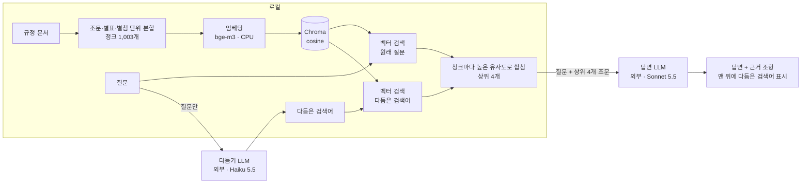

# 포트폴리오 반영 초안 (2026-10-30 작업분)

| 항목 | 내용 |
|---|---|
| 용도 | 오늘 한 검색 튜닝 작업을 Notion 포트폴리오에 반영할 문안 초안. 함께 테스트하다가 "왜 이게 안 되지?"를 따라 바꾸고 실험한 과정을 스토리라인으로 정리했다 |
| 반영 방법 | 담당자가 이 MD를 Notion에 반영한다. 작성 도구에 Notion 연결이 없어 MD로 썼고, 작성 중 Notion 페이지는 열거나 수정하지 않았다 |
| 근거 기록 | [채팅화면과_검색튜닝_실험기록.md](채팅화면과_검색튜닝_실험기록.md), [결정기록_검색어_다듬기_채택.md](결정기록_검색어_다듬기_채택.md), [10-29 검색_튜닝_실험기록.md](../2026-10-29/검색_튜닝_실험기록.md), [10-29 포트폴리오_반영초안.md](../2026-10-29/포트폴리오_반영초안.md) |
| 현재 상태 | **검색 튜닝 1차 적용.** 채팅 화면을 만들었고, 검색 방식을 "검색어 다듬기 + 원래 질문 합치기"로 바꿨다. 보류셋 검증과 답변 품질 평가는 아직 없다 |
| 보안 | 규정 원문, 규정명, 파일명, 평가 질문 문장, 챗봇에 넣은 질문 문장은 넣지 않았다. 수치·개수·문항 번호만 쓴다 |

> 반영할 때 주의: 이 문서에 없는 성과나 수치를 덧붙이지 않는다. 6장 "확인이 더 필요한 사항"이 정리되기 전에는 해당 표현을 확정하지 않는다.

**표기**

| 표기 | 뜻 |
|---|---|
| 나 | 개발자 본인. 테스트하고, 이상을 발견하고, 결정한다 |
| AI 어시스턴트 | 함께 코딩한 Claude. 원인 분석, 개념 설명, 구현, 측정, 기록 정리를 맡았다 |
| 답변 LLM / 다듬기 LLM | 챗봇 안에서 쓰는 부품. 답변은 Claude Sonnet 5.5, 검색어 다듬기는 Claude Haiku 5.5 |
| 규정 A / 규정 B | 규정 A는 정답이 별첨에 있는 사규 규정, 규정 B는 다른 카테고리의 규정 |
| 실험 이름 | 별첨 인식(D7), 하이브리드(M3), 검색어 다듬기(M4), 원래 질문 합치기(M4b). 괄호 안은 실험 기록의 번호 |

---

## 1. 반영 위치 제안

Notion 페이지를 직접 보지 않고 쓴 제안이다. 실제 섹션 이름은 반영할 때 기존 페이지에 맞춘다.

| 페이지 | 갱신할 부분 | 쓸 문안 |
|---|---|---|
| 간략 포트폴리오 | 사내 규정 RAG 챗봇 항목의 요약·상태 줄 | 2장 |
| 상세 포트폴리오 | 사내 규정 RAG 챗봇 항목 본문에 검색 튜닝 이야기 추가 (장면 8개) | 3장 |
| 사내 규정 RAG 챗봇 | 상태 표시, 흐름도 교체, "검색 튜닝" 섹션 신설, 로드맵 표 상태 | 4장 |

---

## 2. 간략 포트폴리오용 문안

**사내 규정 RAG 챗봇** · 상태: 검색 튜닝 1차 적용 (보류셋 검증 전)

- 채팅 화면을 붙여 직접 테스트하며 "왜 이게 안 되지?"를 따라 검색을 고침
- 분할 버그(별첨 미인식)를 찾아 고쳐 **Hit@4 0.89 → 0.96** (평가셋 정답 4문항 수정 포함)
- 하이브리드 검색(BM25 + RRF)은 구현·측정 뒤 미채택: 문제 질문 하나는 좋아졌지만 전체 Hit@4가 0.96 → 0.89로 떨어짐
- LLM 검색어 다듬기 + 원래 질문 합치기 채택: **Hit@4 0.98~1.00**, 구어체 Hit@4 0.71 → 0.86~1.00, 조건 판단 질문 유지(1.00)
- LLM 출력이 흔들리는 실험은 저장한 검색어를 재사용한 짝지은 비교로 판단 (상승폭은 0.05 기준 미만, 보류셋 검증 전)

---

## 3. 상세 포트폴리오용 문안

### 사내 규정 RAG 챗봇: "왜 이게 안 되지?"를 수치로 따라간 검색 튜닝

**상태: 검색 튜닝 1차 적용** (보류셋 검증·답변 품질 평가 전)

#### 한눈에 보기

챗봇에 넣은 구어체 질문 하나가 있어야 할 규정을 놓친 데서 시작해 "왜?"를 따라간 하루다. 분할 버그를 고쳤고, 하이브리드 검색은 수치와 직접 비교로 채택하지 않았고, 검색어 다듬기 + 원래 질문 합치기를 채택했다.

| 누구 | 오늘 한 일 |
|---|---|
| 나 | 직접 질문을 넣어 누락을 발견했다. chunk_id를 보고 별첨 청크가 없다는 것을 찾았다. 하이브리드 수치를 확인하고 두 챗봇을 직접 비교해 판단했다. 평가셋 결과로 채택을 결정했다. 바꾼 이유를 수치로 남기자고 했다 |
| AI 어시스턴트 | 코드에서 원인을 확인했다. 임베딩·BM25·RRF·쿼리 재작성을 설명했다. 검색 모듈·다듬기·합치기를 구현했다. 짝지은 비교를 설계하고 평가를 실행했다. 결정기록을 정리했다 |

"왜?" 사슬

> 예제 그대로 될까? → 왜 있어야 할 규정이 안 나오지? → 같은 뜻인데 왜 구어체면 밀리지? → 단어 일치를 더하면? → 말투를 바꿔 주면? → 왜 조건 판단을 잃었지? → 보류셋은 왜 0문항이지? → 왜 바꿨는지 어떻게 남기지?

```
v0 (Hit@4 0.89)
 └ 별첨 인식 + 정답 4문항 수정 → v1 (0.96) 새 기준선
    ├ + 하이브리드 → M3 (0.89) 미채택
    └ + 검색어 다듬기 → M4 (0.93 / 0.96) 단독 미채택
       └ + 원래 질문 합치기 → M4b (1.00 / 0.98) 채택 (보류셋 검증 전)
```

#### 출발점 (전날까지)

- **구성:** 규정 문서 45개를 조문 단위로 나눈 청크 1,000개를 로컬 임베딩(`bge-m3`, CPU)으로 Chroma에 색인했다. 검색 상위 4개를 LangChain 답변 체인에 넘기면 답변 LLM이 근거와 함께 답한다.
- **평가:** 평가 질문 50개(정답 있음 45, 규정에 없음 5)로 검색만 채점한다. 유형은 단순 사실 20, 조건 판단 10, 여러 조항 8, 구어체 7이다.
- **기준선 v0:** Hit@4 0.89 · Recall@4 0.80 · MRR@10 0.76
- **실험 규칙**
  1. 한 번에 하나만 바꾼다.
  2. 평가셋은 고정한다. 바꾸면 지문(해시)을 새로 적는다.
  3. 튜닝에 쓰지 않는 보류셋 20문항은 기준선과 마지막에만 잰다.
  4. 0.05 미만 변화는 차이로 보지 않는다. 정답 있는 질문이 45개라 한 문제가 약 0.02다.
  5. Hit@4를 먼저 본다. LLM에 넘기는 조문이 4개라서다.
- **진행 방식:** 개념을 쉽게 설명 → 이해 확인 → 구현 순서로 진행했다.

#### 장면 1. 예제 그대로 쓰면 되지 않을까? — 채팅 화면

- **왜?** LangChain 실습 예제의 Gradio 채팅 화면을 그대로 붙이면 될까?
- **알아낸 것:** 화면은 거의 그대로 쓸 수 있다. 다른 점은 하나다. 예제 체인은 검색까지 포함하지만, 이 프로젝트의 체인은 답변만 만든다.
- **바꾼 것**
  - 함수 안에서 먼저 검색하고 답변 체인을 부른다. 답변은 스트리밍으로 보여 준다.
  - 임베딩 모델은 서버를 시작할 때 한 번만 불러온다.
  - 화면에 규정 내용이 나오므로 이 PC에서만 열리게 했다. 공개 링크와 사용 통계도 껐다. 환경 변수로도 바뀌지 않게 코드에 고정했다.
  - 대화 기억은 다음 과제로 미뤘다. 첫 버전은 예제처럼 질문마다 독립적으로 답한다.
- **결과:** 질문 하나로 스트리밍과 답변 끝의 근거 줄을 확인했다. 이제 직접 질문을 넣어 볼 수 있게 됐다.

#### 장면 2. 왜 있어야 할 규정이 답에 안 나오지? — 별첨 인식(D7)

- **계기:** 금액을 묻는 구어체 질문을 넣었더니 규정 B만 답에 나왔다. 나는 같은 지원 기준이 규정 A에도 있다는 것을 알고 있었다.
- **왜?** 규정 A는 왜 안 나오지? "별지로 되어 있어서 그런가?" 하고 chunk_id를 직접 살펴봤다. 조 단위 청크는 있는데, 문서 맨 아래 별첨에 해당하는 청크가 없었다.
- **알아낸 것** (AI 어시스턴트가 코드에서 확인)
  - 분할기의 첨부 제목 패턴이 '별표'와 '별지'만 알아봤다.
  - 그래서 '[별첨 N]' 줄이 제목으로 잡히지 않고 앞 부칙 청크 뒤에 붙어 있었다.
  - 머리말이 '부칙'이라 검색에 불리하고, 답변 LLM도 출처를 '부칙'으로 적게 된다.
- **바꾼 것**
  - **분할:** '별첨'도 첨부 제목으로 인식하게 했다. 긴 별첨은 줄 단위로 자르고, 본문 속 '별첨 N' 참조도 알아본다. 청크는 1,000개에서 1,003개가 됐다(별첨 7개 생성, 부칙 75개 → 71개).
  - **평가셋:** 정답이 그 부칙으로 적혀 있던 4문항은 실제 근거가 부칙 뒤에 숨어 있던 별첨이었다. 기대 답과 후보 청크의 임베딩 유사도로 새 정답을 정했다. 한 별첨이 약 0.73, 나머지는 0.49 이하였다. 규정 본문은 보지 않고 점수만 썼다. 평가셋 지문을 새로 적고, 수정 전 파일은 백업했다.
- **결과**

  | 지표 | v0 | v1 |
  |---|---:|---:|
  | Hit@1 | 0.67 | 0.69 |
  | **Hit@4** | **0.89** | **0.96** |
  | Recall@4 | 0.80 | 0.87 |
  | MRR@10 | 0.76 | 0.80 |

  상위 10개 안에 정답이 없던 4문항 중 3문항이 바로 이 별첨 문항이었다.
- **판단:** 분할과 정답을 함께 바꿔서 두 효과를 가를 수 없다. '한 번에 하나만' 규칙의 예외로 기록하고, 이 상태를 새 기준선 v1로 삼았다.
- **남은 문제:** 별첨 청크가 생겼는데도 그 질문의 정답 별첨은 7위였다. LLM에는 4개만 넘어가니 여전히 답에 안 나온다.

#### 장면 3. 같은 뜻인데 왜 구어체로 물으면 밀리지? — 원인과 선택지

- **계기:** 같은 질문을 두 가지로 검색해 봤다.

  | 같은 질문을 | 정답 별첨 순위 | 정답 유사도 | 1위 유사도 |
  |---|---:|---:|---:|
  | 구어체 그대로 | **7위** (LLM에 안 감) | 0.548 | 0.665 |
  | 규정 용어로 바꿔 써서 | **3위** | 0.708 | 0.744 |

  구어체로 검색하면 상위 10개 중 6개가 금액 표가 많은 다른 규정의 청크였다.
- **왜?** 뜻은 같은데 말투만으로 왜 순위가 갈리지?
- **알아낸 것** (AI 어시스턴트 설명)
  - 임베딩 검색은 단어가 아니라 문장 전체의 뜻을 비교한다. 금액을 묻는 말투에 무게가 실려 금액 표가 끌려온다.
  - 별첨은 문장 없는 표라서 뜻이 흐릿하게 잡힌다.
  - 평가셋에서도 구어체가 가장 약했다. v1 구어체 Hit@4는 0.71(7문항 중 5개)이다.
- **선택지**

  | 선택지 | 기대 효과 | 추가 비용 |
  |---|---|---|
  | 하이브리드 검색 | 단어 일치 점수로 표 형태 청크와 정확한 용어 질문을 보완 | 없음 (LLM 호출 없음) |
  | 검색어 다듬기 | LLM이 질문을 규정 말투로 바꿔 구어체를 보완 | 질문당 LLM 1회 |
  | k 늘리기 (4 → 8) | 더 많이 넘겨 LLM에 맡김 | 외부로 보내는 규정 본문·토큰 2배, 엉뚱한 발췌가 섞임. 검토만 함 |

- **함께 익힌 개념**
  - **BM25:** 흔한 단어는 낮게, 드문 단어는 높게 쳐서 단어 일치를 점수로 매긴다.
  - **형태소 분석(Kiwi):** 한국어는 띄어쓰기로 자르면 조사·어미가 붙어 단어가 안 맞는다. 형태소로 나눠 조사·어미를 떼고 내용 형태소만 남긴다.
  - **RRF:** 단위가 다른 두 점수 대신 순위만 써서 합친다(1/(60+순위)의 합).
- **판단:** AI 어시스턴트는 하이브리드를 먼저 추천했다. 표·핵심 단어 문제에 맞고, 비용이 늘지 않으며, 원래 실험 후보였기 때문이다. 설명을 듣고 내가 진행을 정했다.

#### 장면 4. 단어 일치를 더하면 나아질까? — 하이브리드(M3), 미채택

- **가설:** 표 형태 별첨도 핵심 단어는 그대로 있으니 BM25가 올려 줄 것이다. 전날 세워 둔 가설은 "정확한 용어·조문 번호 질문의 순위가 오른다"였다(볼 지표: 단순 사실 MRR).
- **바꾼 것**
  - 검색 모듈에 형태소 분석 + BM25 + RRF를 넣었다. 두 검색에서 각각 상위 30개 후보를 받아 같은 가중치로 합친다.
  - 설정 하나로 벡터 검색과 하이브리드를 바꿀 수 있게 했다.
  - 청크 파일과 인덱스가 다르면 실행을 멈춘다.
- **결과 (v1 → 하이브리드)**

  | 지표 | v1 | 하이브리드 | 변화 |
  |---|---:|---:|---:|
  | 문제 질문의 정답 순위 | 7위 | 3위 | 개선 |
  | **Hit@4** | **0.96** (43개) | **0.89** (40개) | **−0.07** |
  | Hit@1 | 0.69 | 0.64 | −0.05 |
  | MRR@10 | 0.80 | 0.77 | −0.03 |
  | 단순 사실 MRR | 0.89 | 0.94 | +0.05 (가설 적중) |
  | 조건 판단 Hit@4 | 1.00 | 0.80 | −0.20 |
  | 구어체 Hit@4 / MRR | 0.71 / 0.63 | 0.57 / 0.36 | −0.14 / −0.27 |

  정답 순위가 오른 질문은 6개, 내린 질문은 8개다. 벡터 검색 1위였던 문항 하나는 10위 밖으로 밀렸다.
- **직접 확인:** 수치를 확인해 전체가 떨어진 것을 봤다. 벡터 챗봇과 하이브리드 챗봇을 나란히 띄워 직접 써 본 뒤 "하이브리드가 더 별로인 것 같다"고 판단했다.
- **왜 나빠졌나** (AI 어시스턴트 분석, 추정)
  - RRF는 두 목록에 모두 든 청크를 크게 우대한다. 벡터 1위라도 BM25 후보에 없으면 1/61 ≈ 0.016점이다. 두 목록에서 10위씩인 청크는 2/70 ≈ 0.029점이라 앞선다.
  - 구어체의 일상어는 규정 용어와 단어가 달라서, BM25가 엉뚱한 청크를 고르고 그 청크가 RRF로 올라온다.
  - 질문별 BM25 순위는 확인하지 않았다.
- **판단:** 미채택. 기본값은 벡터 검색으로 두고, 하이브리드는 옵션으로 남겼다. BM25 비중을 낮추거나 점수를 정규화해 합치는 방법은 후보로만 남겼다. 평가셋을 보며 가중치를 여러 번 바꾸면 45문항에만 맞춘 값이 되기 때문이다.
- **교훈:** 문제를 발견한 질문은 7위 → 3위로 좋아졌지만 전체는 나빠졌다. 질문 하나로 판단하지 않는다.

#### 장면 5. 말투를 규정 말투로 바꿔 주면? — 검색어 다듬기(M4), 단독 미채택

- **계기:** 하이브리드에서 구어체가 0.71 → 0.57로 오히려 떨어졌다. 반면 규정 용어로 바꿔 쓴 질문은 3위였다. 문제는 단어가 아니라 말투였다.
- **바꾼 것**
  - 검색 전에 다듬기 LLM(Claude Haiku 5.5, effort low)이 질문을 규정 말투의 검색어 한 줄로 바꾸고, 그 검색어로 검색한다.
  - 답변은 원래 질문으로 만든다. 다듬기가 실패하면 원래 질문으로 검색한다.
  - 프롬프트에는 예시를 넣지 않았다. 평가셋에 자주 나오는 일상어를 예시로 넣으면 평가셋에 맞춘 프롬프트가 되기 때문이다.
- **비용:** 질문당 LLM 호출 1회, 약 1초(측정 1.0~1.3초). 외부로는 질문만 나간다.
- **측정 방법:** LLM 출력이 실행마다 달라서 두 번 쟀다.
- **결과 (v1 → 1회 / 2회)**

  | 지표 | v1 | 검색어 다듬기 |
  |---|---:|---:|
  | 구어체 Hit@4 | 0.71 (5/7) | **0.86 / 1.00** (6 / 7) |
  | 구어체 MRR | 0.63 | 0.79 / 0.82 |
  | Hit@1 | 0.69 | 0.76 / 0.73 |
  | **Hit@4** | **0.96** | **0.93 / 0.96** (변화 없음) |
  | 조건 판단 Hit@4 | 1.00 | **0.80 / 0.80** |
  | 여러 조항 Recall@4 | 0.73 | 0.64 / 0.60 |

  - **얻은 것:** 전날부터 한 번도 못 찾던 문항이 1위가 됐고, 6위였던 문항도 1위가 됐다.
  - **잃은 것:** 조건 판단 문항 2개가 두 번 모두 4위 밖으로 밀렸다.
  - **흔들린 것:** 같은 설정인데도 2문항의 순위가 실행마다 달랐다.
- **판단:** 단독으로는 미채택하고 옵션으로만 두었다. 구어체는 분명히 올랐지만 Hit@4는 그대로였고, 조건 판단 하락이 두 번 모두 재현됐다. 검색어를 한 줄로 줄이면서 조건이 빠진 것으로 추정한다.

#### 장면 6. 왜 조건 판단을 잃었지? — 원래 질문 합치기(M4b)

- **계기:** 다듬기에서 밀린 조건 판단 문항들은 원래 질문으로 검색하면 1~3위였다.
- **왜?** 다듬기의 이득은 지키면서, 원래 질문이 잘 찾던 것을 잃지 않을 수는 없을까?
- **바꾼 것**
  - 원래 질문과 다듬은 검색어로 각각 검색하고, 같은 청크는 더 높은 유사도를 쓴다.
  - 두 검색은 같은 임베딩, 같은 코사인 척도라 점수를 그대로 비교할 수 있다. 그래서 RRF가 필요 없고, 하이브리드에서 문제였던 순위 합치기를 피한다.
  - 검색어마다 상위 4개만 찾아도 합친 상위 4개는 정확하다. 어느 목록에서도 4위 밖인 청크는 합쳐도 4위 안에 들 수 없기 때문이다.
- **공정한 비교 설계**
  - LLM 출력이 흔들려서, 다듬기 실험 때 저장해 둔 검색어를 그대로 재사용했다. 검색어는 같고 합치는 방식만 다른 짝지은 비교이며, API를 다시 부르지 않았다.
  - 재사용이 제대로 되는지는 이전 결과 두 개(v1, 다듬기 1회)를 다시 채점해 똑같이 나오는 것으로 확인했다.
- **결과 (v1 → 1회 / 2회 검색어)**

  | 지표 | v1 | 원래 질문 합치기 |
  |---|---:|---:|
  | **Hit@4** | **0.96** (43개) | **1.00 / 0.98** (45 / 44개) |
  | 조건 판단 Hit@4 / MRR | 1.00 / 0.62 | **1.00 / 0.82** |
  | 구어체 Hit@4 | 0.71 | 1.00 / 0.86 |
  | Recall@4 | 0.87 | 0.91 / 0.90 |
  | MRR@10 | 0.80 | 0.86 / 0.84 |
  | 여러 조항 MRR | 0.94 | 0.85 / 0.84 (손실) |

  - 다듬기의 이득은 지켰다(5문항). 다듬기에서 밀린 3문항은 v1 순위로 돌아왔다.
  - 남은 손실은 2문항이다. 둘 다 1위였다가 2~4위로 내려갔다.
  - 두 번째 검색어 세트에서만 2문항이 더 내려갔다(1위 → 4위, 4위 → 5위). 그래서 이 세트의 Hit@4가 0.98이다.
  - 예상한 위험도 일부 나타났다. 다듬은 검색어 쪽 유사도가 전반적으로 높아서(정답 있는 질문의 1등 유사도 평균 0.682 → 0.711~0.712), 원래 질문의 정답 점수를 덮는 경우가 있었다.
- **크기:** Hit@4 상승폭 +0.02~0.04는 0.05 기준보다 작다. v1이 이미 45문항 중 43개라 오를 수 있는 폭이 최대 0.04였다. 그래서 Hit@4와 별개인 유형별 변화(조건 판단 MRR, 구어체 Hit@4)로 판단을 보충했다. 이 보충 기준은 미리 정한 규칙에 없던 것이다.
- **직접 확인:** 내가 챗봇으로 먼저 확인하자고 해서 이 방식의 챗봇을 따로 띄웠다. 처음 문제였던 질문을 넣자 답변 맨 위에 다듬은 검색어가 보였다. 답변에는 두 규정의 기준이 함께 나왔고, 근거 줄에 규정 A의 별첨이 인용됐다. 질문 하나를 한 번 본 확인이다.
- **판단:** AI 어시스턴트가 채택 후보로 제안했다. 처음으로 v1보다 낮아진 전체 지표가 없었고, 두 검색어 세트에서 방향도 같았다.

#### 장면 7. 보류셋은 왜 0문항이지? — 마지막 관문과 채택

- **계기:** 규칙대로, 채택하기 전에 튜닝에 쓰지 않은 보류셋 20문항으로 확인하려 했다.
- **왜?** 20문항이 모두 빠졌다. 정답 칸이 아직 작성되지 않은 상태였다. 채점한 문항이 0개라 API 호출도 없었다.
- **함께 점검한 것**
  - 별첨 분리로 내용이 바뀐 조문이 평가셋 정답에 쓰이지 않는 것을 확인했다. 보류셋은 정답을 아직 쓰지 않아 해당이 없고, 정답을 채울 때 현재 분할을 기준으로 쓴다.
  - 결과 파일 이름에 평가셋 이름을 넣었다. 튜닝 중에 보류셋 결과를 실수로 열지 않기 위해서다.
- **판단:** 평가셋 결과만으로 채택하기로 내가 결정했다. 실험 규칙의 예외로 기록했다. 보류셋 정답을 채운 뒤 다시 재서 나쁘면 되돌린다는 조건도 달았다.
- **반영**
  - 채팅 화면의 기본 검색을 이 방식으로 바꿨다. 끄는 옵션도 있다.
  - 실험 도구의 기본값은 벡터 검색 그대로 뒀다. 외부 전송이 없고 결과가 실행마다 같아야 비교 실험에 쓸 수 있기 때문이다.
- **늘어난 비용:** 질문당 LLM 호출이 1회에서 2회가 됐다(다듬기 + 답변). 다듬기 지연은 약 1초이고, 임베딩 검색도 1회 늘었다.

#### 장면 8. 왜 바꿨는지 어떻게 남기지? — 결정기록

- **계기:** 무엇을 바꿨는지보다 "왜 이렇게 바꿔 봤느냐"가 중요하다고 보고, 바꾼 이유를 수치와 함께 남기기로 했다.
- **한 일**
  - 선택지마다 "왜 시도했나 → 수치 → 판단"을 정리한 결정기록을 남겼다. AI 어시스턴트가 정리했고, 결정자는 나다.
  - 실험하지 않은 선택지(k 늘리기, 구어체 용어 사전)도 이유와 함께 적었다.
  - 판단 기준 5개(Hit@4 → 잃지 않을 것 → 구어체 개선 → 비용·지연·외부 전송 → 재현성)는 이날 실험을 거치며 정리한 것이다.

#### 결과 요약

| 단계 | 바꾼 것 | Hit@4 (45문항) | 구어체 Hit@4 (7) | 조건 판단 Hit@4 (10) | 문제 질문 순위 | 판단 |
|---|---|---:|---:|---:|---:|---|
| v0 | 기준선 | 0.89 | 0.71 | 0.90 | 별첨 청크 없음 | 기준선 |
| v1 | 별첨 인식 + 정답 4문항 수정 | 0.96 (43) | 0.71 (5) | 1.00 (10) | 7위 | 새 기준선 (규칙 예외) |
| M3 | v1 + 하이브리드 | 0.89 (40) | 0.57 (4) | 0.80 (8) | 3위 | 미채택 |
| M4 | v1 + 검색어 다듬기 | 0.93 / 0.96 | 0.86 / 1.00 | 0.80 / 0.80 | 3위 | 단독 미채택 |
| M4b | M4 + 원래 질문 합치기 | 1.00 / 0.98 | 1.00 / 0.86 | 1.00 / 1.00 | 3위 | 채택 (보류셋 검증 전) |

| 참고 지표 | Hit@1 | Recall@4 | MRR@10 | 여러 조항 MRR |
|---|---:|---:|---:|---:|
| v0 | 0.67 | 0.80 | 0.76 | 0.94 |
| v1 | 0.69 | 0.87 | 0.80 | 0.94 |
| M3 | 0.64 | 0.80 | 0.77 | 0.88 |
| M4 | 0.76 / 0.73 | 0.84 / 0.85 | 0.84 / 0.82 | 0.92 / 0.91 |
| M4b | 0.76 / 0.73 | 0.91 / 0.90 | 0.86 / 0.84 | 0.85 / 0.84 |

- 'A / B' 값: M4는 LLM 실행 1회 / 2회이고, M4b는 그 1회 / 2회 검색어를 재사용한 짝이다.
- v0 → v1에는 두 변화(별첨 인식, 정답 수정)가 섞여 있어서 하나의 원인으로 설명하지 않는다.
- M3와 M4는 각각 v1에서 갈라진 실험이고, M4b만 M4 위에 쌓았다.

#### 배운 점

1. **질문 하나로 판단하지 않는다.** 하이브리드는 문제를 발견한 질문을 7위 → 3위로 올렸지만, 전체 Hit@4는 0.07 떨어졌다.
2. **같은 척도의 점수는 순위가 아니라 점수로 합친다.** 단위가 다른 점수를 순위로 합친 RRF는 두 목록에 걸친 청크를 지나치게 올렸다. 같은 코사인 척도인 두 검색은 높은 점수로 합쳐 조건 판단 질문을 지켰다.
3. **LLM이 끼는 실험은 입력을 고정해 비교한다.** 실행마다 1~2문항이 흔들려서, 저장한 검색어를 재사용한 짝지은 비교로 합치기의 효과만 따로 쟀다.
4. **모델보다 데이터 버그를 먼저 의심한다.** 별첨을 알아보지 못한 분할 버그 하나를 고친 뒤 Hit@4가 0.89에서 0.96이 됐다(정답 수정 포함).
5. **규칙을 벗어난 판단은 드러내 적는다.** v1을 새 기준선으로 삼은 것, 0.05 기준에 못 미쳐 유형별 변화로 판단을 보충한 것, 보류셋 없이 채택한 것을 모두 예외로 기록했다.

#### 한계와 다음 단계

- **보류셋으로 검증하지 못했다.** 정답이 아직 작성되지 않아, 평가셋 결과만으로 채택했다.
- **표본이 작다.** 구어체는 7문항이라 1문항 차이가 약 0.14다.
- **검색 지표만 쟀다.** 답변 품질(정확성·근거 인용)은 평가하지 않았다.
- **손실도 있다.** 여러 조항 MRR이 0.94에서 0.85 / 0.84로 떨어졌다.
- **유사도로 미리 거절할 수 없다.** 정답 있는 질문의 1등 유사도 최소(0.610 / 0.616)가 규정에 없는 질문의 최대(0.628)보다 낮다.
- **확정된 다음 단계:** 보류셋 정답을 채운 뒤 v1과 M4b를 다시 잰다. M4b가 나쁘면 되돌린다.
- **후보로 남긴 것:** 답변 품질 평가, 합칠 때 점수 보정, 하이브리드 가중치 조정, 대화 기억.

---

## 4. 사내 규정 RAG 챗봇 페이지용 문안

### 4-1. 상태 표시

> **상태:** 검색 튜닝 1차 적용 — 채팅 화면, 별첨 인식, 검색어 다듬기 + 원래 질문 합치기 적용. 보류셋 검증과 답변 품질 평가는 아직 없음

### 4-2. 흐름도

10-29 흐름도를 아래로 바꾼다. Notion의 코드 블록에서 언어를 Mermaid로 지정하면 그림으로 보인다.



Mermaid를 쓰지 않을 때의 텍스트 버전

```
[로컬]  규정 문서 → 조문·별표·별첨 분할(청크 1,003) → bge-m3 임베딩 → Chroma
        질문 ──────────────→ 벡터 검색 ─┐
        다듬은 검색어 ─────→ 벡터 검색 ─┴→ 청크마다 높은 유사도로 합침 → 상위 4개
[외부]  질문 → 다듬기 LLM(Haiku 5.5) → 다듬은 검색어
        질문 + 상위 4개 조문 → 답변 LLM(Sonnet 5.5) → 답변 + 근거 조항
```

### 4-3. 새 섹션: 검색 튜닝

**무엇을 했나**

채팅 화면으로 직접 테스트하다가, 있어야 할 규정이 답에서 빠지는 것을 발견했다. 원인을 따라가 분할 버그(별첨 미인식)를 고쳤다. 남은 문제인 구어체 질문을 두고 검색 방식 세 가지를 같은 평가셋으로 비교해, "검색어 다듬기 + 원래 질문 합치기"를 채택했다.

**실험 결과** (평가 질문 50개, 정답 있는 질문 45개 기준)

| 방식 | Hit@4 | Hit@1 | MRR@10 | 구어체 Hit@4 | 조건 판단 Hit@4 | 판단 |
|---|---:|---:|---:|---:|---:|---|
| 벡터 검색 (v1) | 0.96 | 0.69 | 0.80 | 0.71 | 1.00 | 기준선 |
| 하이브리드 (BM25 + RRF) | 0.89 | 0.64 | 0.77 | 0.57 | 0.80 | 미채택 |
| 검색어 다듬기 | 0.93 / 0.96 | 0.76 / 0.73 | 0.84 / 0.82 | 0.86 / 1.00 | 0.80 / 0.80 | 단독 미채택 |
| **검색어 다듬기 + 원래 질문 합치기** | **1.00 / 0.98** | 0.76 / 0.73 | 0.86 / 0.84 | 1.00 / 0.86 | 1.00 / 1.00 | **채택** |

'A / B'는 LLM이 다듬은 검색어 2세트의 결과다. 마지막 줄은 앞 줄과 같은 검색어를 재사용해 합치는 방식만 바꾼 짝지은 비교다.

**채택한 방식**

- 검색 전에 다듬기 LLM이 질문을 규정 말투의 검색어 한 줄로 바꾼다. 외부로는 질문만 나간다.
- 원래 질문과 다듬은 검색어로 각각 검색하고, 같은 청크는 더 높은 유사도를 쓴다. 두 검색은 같은 코사인 척도라 순위 결합(RRF)이 필요 없다.
- 답변은 원래 질문으로 만들고, 답변 맨 위에 다듬은 검색어를 보여 준다. 다듬기가 실패하면 원래 질문으로 검색한다.
- 비용: 질문당 LLM 호출 1회(약 1초)와 임베딩 검색 1회가 늘었다.

**한계**

- 보류셋 검증 전이다. 평가셋 결과만으로 채택했다.
- Hit@4 상승폭(+0.02~0.04)은 실험 규칙의 0.05 기준보다 작다. v1이 이미 43/45라 오를 수 있는 폭이 최대 0.04였다.
- 여러 조항 MRR이 0.94에서 0.85 / 0.84로 떨어졌다.
- 검색 지표만 쟀고, 답변 품질은 평가하지 않았다.

### 4-4. 로드맵 표 상태 변경 제안

10-29 초안 4-4의 표를 기준으로 한 제안이다. 실제 Notion 표와 다르면 반영할 때 맞춘다.

| Phase | 기존 내용 | 제안 상태 | 메모 |
|---|---|---|---|
| 1 | PDF 로딩 · 조문 단위 분할 · 메타데이터 설계 | ✅ 완료 | 별첨 인식 추가, 청크 1,003개 |
| 2 | Chroma 인덱싱 + 하이브리드 검색 + LCEL RAG 체인 | ✅ 완료 | 하이브리드(BM25 + RRF)는 구현·측정 뒤 미채택(Hit@4 0.96 → 0.89), 옵션으로 유지 |
| 3 | 평가셋 구축, 검색 지표 측정 | 🔶 일부 완료 | 평가셋 50문항 기준선 v1. 보류셋 20문항은 정답 미작성 |
| 4 | Re-rank 등 고도화 | 🔶 일부 진행 | 쿼리 재작성(검색어 다듬기 + 원래 질문 합치기) 채택. 리랭커는 미적용 |
| (UI) | 채팅 화면 | ✅ 첫 버전 | Gradio, 이 PC에서만 열림, 대화 기억 없음 |

---

## 5. 수치 대조표

초안에 쓴 수치와 근거 위치다. 반영할 때 이 표에 없는 수치는 쓰지 않는다. "실험기록"은 10-30 [채팅화면과_검색튜닝_실험기록](채팅화면과_검색튜닝_실험기록.md), "결정기록"은 10-30 [결정기록_검색어_다듬기_채택](결정기록_검색어_다듬기_채택.md)이다.

| 수치 | 값 | 근거 |
|---|---|---|
| 문서 / 처음 청크 수 | 45 / 1,000 | 10-29 검색_튜닝_실험기록 2장 조건 |
| 평가 질문 / 유형 | 50 (정답 있음 45) / 단순 사실 20, 조건 판단 10, 여러 조항 8, 구어체 7 | 10-29 검색_튜닝_실험기록 2장 조건 |
| v0 Hit@1 / Hit@4 / Recall@4 / MRR@10 | 0.67 / 0.89 / 0.80 / 0.76 | 10-29 검색_튜닝_실험기록 2장 결과 |
| v0 조건 판단 / 구어체 Hit@4 | 0.90 / 0.71 | 10-29 검색_튜닝_실험기록 2장 결과 |
| v0 여러 조항 MRR | 0.94 | 10-29 검색_튜닝_실험기록 2장 결과 |
| 청크 / 별첨 / 부칙 | 1,000 → 1,003 / 7개 / 75 → 71 | 실험기록 2장 변경 |
| 평가셋 정답 수정 | 4문항, 유사도 약 0.73 vs 0.49 이하 | 실험기록 2장 평가셋 수정 |
| v1 Hit@1 / Hit@4 / Recall@4 / MRR@10 | 0.69 / 0.96 / 0.87 / 0.80 | 실험기록 2장 결과 |
| v1 유형별 (Hit@4 / MRR) | 조건 판단 1.00 / 0.62, 여러 조항 1.00 / 0.94 (Recall@4 0.73), 구어체 0.71 / 0.63, 단순 사실 1.00 / 0.89 | 실험기록 2장 결과 |
| 문제 질문 순위·유사도 | 7위 (0.548, 1위 0.665) / 3위 (0.708, 1위 0.744), 상위 10개 중 6개 | 결정기록 1장 |
| M3 Hit@1 / Hit@4 / Recall@4 / MRR@10 | 0.64 / 0.89 / 0.80 / 0.77 | 실험기록 3장 결과 |
| M3 유형별 | 단순 사실 MRR 0.94, 조건 판단 Hit@4 0.80, 여러 조항 MRR 0.88, 구어체 Hit@4 0.57 / MRR 0.36 | 실험기록 3장 결과 |
| M3 순위 변화 | 오름 6, 내림 8 | 실험기록 3장 결과 |
| M3 후보 수·RRF 상수 | 각 30 / 60 | 실험기록 3장 조건 |
| RRF 계산 | 1/61 ≈ 0.016, 2/70 ≈ 0.029 | 실험기록 3장 해석 2 |
| M4 (1회 / 2회) | Hit@1 0.76 / 0.73, Hit@4 0.93 / 0.96, Recall@4 0.84 / 0.85, MRR 0.84 / 0.82 | 실험기록 4장 결과 |
| M4 유형별 | 구어체 Hit@4 0.86 / 1.00, MRR 0.79 / 0.82, 조건 판단 Hit@4 0.80 / 0.80, 여러 조항 Recall@4 0.64 / 0.60, MRR 0.92 / 0.91 | 실험기록 4장 결과 |
| 다듬기 지연 | 질문당 약 1초 (측정 1.0~1.3초) | 결정기록 4.2 |
| M4b (1회 / 2회 검색어) | Hit@1 0.76 / 0.73, Hit@4 1.00 / 0.98, Recall@4 0.91 / 0.90, MRR 0.86 / 0.84 | 실험기록 5장 결과 |
| M4b 유형별 | 조건 판단 1.00 / 0.82 (두 세트 같음), 구어체 Hit@4 1.00 / 0.86, 여러 조항 MRR 0.85 / 0.84 | 실험기록 5장 결과 |
| 1등 유사도 평균 | 0.682 → 0.711~0.712 | 결정기록 6장 |
| 미리 거절 기준 | 정답 있는 질문 최소 0.610 / 0.616, 규정에 없는 질문 최대 0.628 | 실험기록 5장 해석 6 |
| 보류셋 | 20문항, 정답 미작성, 채점 0 | 실험기록 5장 보류셋 확인 |

---

## 6. 확인이 더 필요한 사항

| 항목 | 내용 | 확인 전 처리 |
|---|---|---|
| 공개 범위 | 오늘 실험은 실제 규정 기반 인덱스로 했다. 외부 LLM API로는 답변 단계에서 질문과 상위 4개 조문을, 다듬기 단계에서 질문을 보낸다. 다듬기 실험 2회 때 평가 질문 50개도 질문만 외부로 보냈다. 10-29 초안의 미결 사항(기존 페이지의 "가상 규정 샘플" 문구, 실제 규정 사용을 어디까지 밝힐지)과 같은 문제다 | 문안에는 "외부 LLM API로 무엇을 보내는가"까지만 썼다. "실제 규정"이라는 표현은 넣지 않았다 |
| 평가셋 정답 4문항 수정 | AI 어시스턴트가 기대 답과의 임베딩 유사도로 별첨에 대응시키고 보고했다. 담당자가 규정을 보고 검수하지는 않았다 | v0 → v1 개선에는 "정답 수정 포함"이라는 단서를 붙였다 |
| 보류셋 | 정답이 아직 작성되지 않았다. M4b 채택은 평가셋 결과만으로 했다 | 문안 곳곳에 "보류셋 검증 전"을 적었다 |
| 답변 품질 | 채팅 화면에서 질문 몇 개를 확인했을 뿐, 답변 정확도는 평가하지 않았다 | 답변 품질이나 정확도 표현은 쓰지 않았다 |
| 문제 질문의 주제 | 문제 질문의 주제와 처음 답에 나온 규정의 카테고리는 일반화했다 | "금액을 묻는 구어체 질문", "다른 카테고리의 규정"으로 썼다 |
| 기존 로드맵 표 | Notion의 로드맵 표가 10-29 초안의 가정과 같은지 확인하지 못했다 | 4-4는 가정을 밝힌 제안으로만 썼다 |
| 회사명·규정명 | 문안에는 넣지 않았다 | 넣지 않음 |

---

## 부록. 질문별 정답 순위 변화

본문에서 숫자로만 쓴 질문의 번호다. 평가셋에서 순위가 한 번이라도 바뀐 질문만 적었다. 순위는 정답이 처음 나온 자리이고, '밖'은 상위 10개 밖이다. M4·M4b는 1회 / 2회 값이다.

| 질문 | 유형 | v1 | M3 하이브리드 | M4 다듬기 | M4b 합치기 |
|---|---|---:|---:|---:|---:|
| Q02 | 단순 사실 | 2 | 1 | 2 / 2 | 2 / 2 |
| Q05 | 단순 사실 | 1 | 1 | 1 / 4 | 1 / 4 |
| Q09 | 단순 사실 | 3 | 1 | 3 / 3 | 3 / 3 |
| Q12 | 단순 사실 | 2 | 3 | 2 / 2 | 2 / 2 |
| Q21 | 조건 판단 | 3 | 1 | 5 / 6 | 3 / 3 |
| Q22 | 조건 판단 | 2 | 2 | 1 / 1 | 1 / 1 |
| Q23 | 조건 판단 | 2 | 2 | 4 / 4 | 2 / 2 |
| Q25 | 조건 판단 | 1 | 밖 | 6 / 5 | 1 / 1 |
| Q26 | 조건 판단 | 4 | 2 | 1 / 1 | 1 / 1 |
| Q27 | 조건 판단 | 3 | 2 | 1 / 1 | 1 / 1 |
| Q28 | 조건 판단 | 3 | 7 | 3 / 3 | 3 / 3 |
| Q32 | 여러 조항 | 1 | 2 | 1 / 1 | 1 / 1 |
| Q35 | 여러 조항 | 1 | 1 | 3 / 4 | 3 / 4 |
| Q37 | 여러 조항 | 2 | 2 | 1 / 1 | 2 / 2 |
| Q39 | 구어체 | 1 | 4 | 2 / 2 | 2 / 2 |
| Q40 | 구어체 | 6 | 2 | 1 / 1 | 1 / 1 |
| Q41 | 구어체 | 4 | 10 | 밖 / 4 | 4 / 5 |
| Q42 | 구어체 | 1 | 2 | 1 / 1 | 1 / 1 |
| Q43 | 구어체 | 밖 | 밖 | 1 / 1 | 1 / 1 |
| Q44 | 구어체 | 1 | 6 | 1 / 1 | 1 / 1 |

- 장면 2의 "상위 10개 밖이던 별첨 문항 3개"는 Q03·Q04·Q27이다(v0 기준). 정답을 고친 4문항은 Q03·Q04·Q27·Q32다.
- 장면 5의 "한 번도 못 찾던 문항"은 Q43, "6위였던 문항"은 Q40, "4위 밖으로 밀린 조건 판단 2문항"은 Q21·Q25, "흔들린 2문항"은 Q05·Q41이다.
- 장면 6의 "다듬기의 이득 5문항"은 Q22·Q26·Q27·Q40·Q43, "v1 순위로 돌아온 3문항"은 Q21·Q23·Q25, "남은 손실 2문항"은 Q35·Q39, "두 번째 검색어 세트에서만 내려간 2문항"은 Q05·Q41이다.
