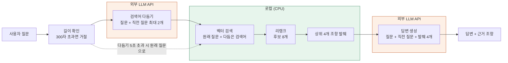

# 사내 규정 RAG 챗봇 — 답변보다 검색을 먼저 고친 기록

> 자기개발 프로젝트 · 2026.10.26 ~ 진행 중 · 1인 (Claude Code와 함께 구현·실험)
> 상태: 개인 노트북용 1차 버전 완료(11-04). 여러 조항 검색 개선(2차) 진행 중
> 이 글에는 규정 원문·규정명·실제 질문을 넣지 않았다. 수치는 각 날짜 평가 조건과 함께 적었다.

## 1. 출발점

LangChain 강의 6개 섹션과 실습을 마치고, 실제로 불편했던 사내 규정 검색에 적용해 보기로 했다. 규정은 PDF·DOCX 수십 개에 흩어져 있어 조항을 찾기 어렵다. 그렇다고 일반 LLM에 바로 물으면 회사 규정이 아니라 일반론으로 답하거나 근거를 지어낸다. 그래서 목표를 "답하는 챗봇"이 아니라 **"근거 조항을 함께 보여 주고, 규정 전체는 밖으로 보내지 않는 챗봇"**으로 잡았다.

만들어 보니 먼저 풀어야 했던 문제는 답변 생성이 아니라 **답변에 쓸 조항을 제대로 찾는 일**이었다.

## 2. 제약이 정한 설계

첫날 정한 요구사항은 두 가지였다. 규정이므로 전부 외부로 보내고 싶지 않고, 노트북에 GPU가 없다. 이 두 조건을 함께 만족하는 구성은 하나뿐이었다.

| 제약 | 설계 |
|---|---|
| 규정 전체를 외부로 보내지 않음 | 적재·분할·임베딩·검색·리랭크는 로컬에서 처리 |
| GPU 없음 | 임베딩·리랭크는 CPU, 무거운 답변 생성만 외부 LLM API |
| 근거 조항 제시 | 조항 단위로 분할하고, 규정 위치와 조항 ID를 메타데이터로 보존 |
| 혼자 개발 | 처음 계획은 Python과 Spring AI로 같은 RAG를 두 번 구현하는 것이었다. "어느 쪽이 포트폴리오에 더 도움이 되나"를 기준으로 다시 따져 Python 하나로 결정했다. 한국어 형태소 분석·리랭커 같은 검색 고도화 도구가 Python 쪽에 많고, 새 기능도 먼저 나오기 때문이다. 줄인 시간은 평가와 검색 튜닝에 썼다 |

## 3. 측정할 수 있는 기반부터

- **분할:** 문서 45개(PDF 41, DOCX 4. 엑셀 2개는 제외)를 정규식으로 장·조·항·별표 단위로 나눴다. 결과는 `chunks.jsonl`로 먼저 저장해 임베딩 전에 확인했다. "분할이 잘 됐는지 숫자로 볼 수 없나"라는 질문에서 지표 두 개를 만들었다. 원문 보존율 96%, 구조 기준 분할 97.9%(10-28)다. 다만 이 숫자는 규칙대로 잘렸다는 뜻이지 검색이 잘 된다는 뜻은 아니다.
- **평가셋:** 50문항(정답 있음 45, 규정에 없음 5). 유형은 단순 사실 20, 조건 판단 10, 여러 조항 8, 구어체 7이다. 정답 조항은 규정을 보고 직접 채웠다.
- **지표:** LLM에 넘기는 발췌가 4개이므로 Hit@4(상위 4개 안에 정답이 있나)를 1순위로 봤다. 정답이 여러 개인 질문은 Recall@4(몇 개를 가져왔나), 순위는 MRR로 봤다.
- **실험 규칙:** 한 번에 하나만 바꾼다. 선택 규칙은 결과를 보기 전에 적는다. 0.05 미만의 차이는 무시한다(1문항 ≈ 0.02). 보류셋 20문항은 튜닝에 쓰지 않는다.
- **보안:** 규정 원문을 AI 도구에 넣지 않으려고 모든 스크립트가 점수·개수·ID만 출력하게 했다. 이 제약 때문에 만든 집계 출력과 정답 ID 대조가 그대로 품질 관리 도구가 됐다.

## 4. 시행착오: 무엇을 채택하고 무엇을 버렸나

**① 첫 평가는 무효였다 (10-29).** 50문항 중 39문항이 "정답 ID가 인덱스에 없음"으로 빠졌다. 분할을 다시 하고 인덱스를 다시 만들지 않아서 인덱스에는 조문 125개, 청크 파일에는 937개가 있었다. 다시 색인하자 50문항이 모두 채점됐다. 점수를 보기 전에 데이터·청크·인덱스·정답 ID가 같은 버전인지부터 확인하게 됐다. 기준선 v0은 Hit@4 0.89, Recall@4 0.80, MRR 0.76이었다.

**② 직접 써 보다가 분할 오류를 찾았다 (10-30).** 채팅 화면에서 구어체로 물었는데 정답 규정의 부속 문서가 나오지 않았다. 조항 ID를 따라가 보니 `별첨` 청크가 하나도 없었다. 분할기가 별표·별지만 제목으로 인식해서, 별첨 내용이 앞 부칙 청크 뒤에 붙어 있었다. 별첨 인식을 추가하자 청크가 1,000개에서 1,003개로 늘었다. 같은 원인으로 잘못 적혀 있던 평가셋 정답 4개도 바로잡았다. 이후 Hit@4 0.96, Recall@4 0.87, MRR 0.80이 나왔지만, **분할 수정과 정답 수정이 함께 들어간 새 기준선(v1)**이라 분할 수정만의 효과로 볼 수는 없다.

**③ 하이브리드 검색은 버렸다.** 정확한 규정 용어에는 키워드 검색이 도움이 될 거라고 보고 Kiwi 형태소 분석 + BM25 + RRF를 붙였다. 가설대로 단순 사실 MRR은 0.89에서 0.94로 올랐다. 하지만 전체 Hit@4가 0.96에서 0.89로, 풀려던 구어체 Hit@4는 0.71에서 0.57로 떨어졌다. 채팅 화면 두 개를 나란히 띄워 비교해 봐도 같았다. 문제를 찾게 한 그 질문은 7위에서 3위로 좋아졌지만, 질문 하나가 좋아진 것만으로는 채택하지 않았다.

**④ 검색어 다듬기는 혼자 쓰기엔 불안했다.** 구어체 문제는 단어가 아니라 말투 차이였다. 그래서 LLM(Claude Haiku)이 질문을 규정 말투의 검색어 한 줄로 바꾸게 했다. 구어체 Hit@4는 0.71에서 0.86~1.00으로 올랐다. 대신 조건 판단 Hit@4가 두 번 실행에서 모두 1.00에서 0.80으로 떨어졌고, 같은 설정인데도 실행마다 1~2문항이 달라졌다.

**⑤ 원래 질문과 다듬은 검색어를 합쳤다 (채택).** 두 검색어로 각각 검색한 뒤 청크마다 높은 코사인 유사도를 썼다. 두 검색이 같은 척도라 RRF가 필요 없었다. LLM 출력 변화와 결합 효과를 가르려고, 저장해 둔 같은 검색어로 짝지어 비교했다. 결과는 Hit@4 1.00 / 0.98, Recall@4 0.91 / 0.90(검색어 세트 2종)이었다. 처음으로 v1보다 낮아진 전체 지표가 하나도 없었다. 다만 보류셋 정답을 아직 채우지 못해서, 규칙의 예외로 **평가셋 결과만 보고 채택**했다. 이 사실은 결정 기록에 남겼다.

**⑥ 리랭커와 후보 8개.** 정답이 상위권에는 있지만 1위가 아닌 문제가 남아, 로컬 Cross-Encoder(`bge-reranker-v2-m3`)를 붙였다. 리랭크 시간 예산은 "상위 10% 질문도 5초 안"으로 정했다. 후보 5개를 다듬은 검색어로 재정렬하자 Hit@1이 0.76에서 0.89, 0.73에서 0.82로 올랐고 Hit@4는 그대로였다(11-03). 그래도 여러 조항 질문이 가장 약했다. 11-04에 원인을 진단해 보니, 놓친 정답은 모두 검색 상위 20개 안에 있었고 주로 6~11위, 즉 리랭크 후보 바로 밖에 있었다. 중복 제거나 참조 조항 따라가기는 이 데이터에서 원인이 아니었다. 그래서 후보 수를 비교했다.

| 리랭크 후보 | 여러 조항 Recall@4 (세트 1 / 2) | Hit@4 | 리랭크 p90 | 판정 |
|---|---|---|---|---|
| 5개 (이전) | 0.76 / 0.69 | 1.00 / 1.00 | 2.7 / 3.0초 | – |
| **8개** | **0.90 / 0.81** | 1.00 / 1.00 | 3.9 / 4.4초 | **채택** |
| 10개 | 0.92 / 0.81 | 0.98 / 1.00 | 4.9 / 5.2초 | 탈락 (Hit@4 하락, 시간 초과) |

*평가셋 오프라인 측정 · 여러 조항 8문항 · 저장된 검색어 세트 2종 기준*

리랭커는 8개를 보지만 외부 LLM으로 보내는 발췌는 그대로 4개다. 검색어별로 몫을 나눠 후보를 모으는 방식은 후보 8개와 다른 질문을 고쳤다. 그렇다고 결과를 보고 나서 둘을 섞으면 평가셋에 맞춘 설정이 될 수 있어서, 이번에는 섞지 않고 다음 비교 후보로 미리 적어 두었다.

## 5. 현재 구조와 외부 전송 범위

- 임베딩·색인·검색·리랭크는 모두 로컬에서 처리한다. 외부로 가는 것은 다듬기용 질문, 답변용 질문 + 발췌 4개뿐이다.
- 후속 질문을 이해하도록 같은 대화의 **직전 사용자 질문** 최대 2개를 함께 보낸다. 이전 답변과 발췌는 다시 보내지 않는다. 이전 답의 오류가 다음 답으로 이어지는 것도 막기 위해서다.
- OpenAI 요청에 `store=False`를 넣었고, Gradio 기록 기능을 끄고, 채팅은 `127.0.0.1`에서만 열린다.
- 이 조치들은 전송량과 로컬 기록을 줄이는 구현일 뿐 **정보보안 승인을 대신하지 않는다.** 실제 규정 사용은 10-29에 승인받았다. 그 뒤 수신처가 OpenAI로 바뀌었고 직전 질문도 함께 보내게 됐으므로, 지금 전송이 승인 범위에 드는지는 아직 확인하는 중이다.

## 6. 한계와 다음 단계

**확인하지 못한 것**
- 실제 답변·다듬기 모델은 11-02부터 OpenAI `gpt-5.4-mini`다. 그런데 effort·프롬프트·리랭커 설정은 Claude 기준 평가와 로컬 검색 측정으로 정했다. 공급자를 바꿀 때마다 다시 평가하면 결정이 끝나지 않으므로 OpenAI 기준 재평가는 하지 않기로 했고, 이 한계를 README에 적었다.
- 보류셋 정답이 비어 있어 과적합 여부를 검증하지 못했다. 여러 조항 문항이 8개뿐이라 일반화에도 한계가 있다.
- 후보 8개의 개선은 검색어 세트 2종에 대한 오프라인 측정이다. 모든 실제 질문에서 나아진다는 보장은 없다.
- 후속 질문의 실사용 확인, 실사용 중 "찾을 수 없음"으로 답한 질문의 원인 확인, 외부 전송 승인 범위 확인이 남아 있다.

**다음 후보**
1. 후보 8개와 검색어별 몫을 합친 설정 — 규칙을 먼저 적고 비교한다
2. 다듬기 effort를 `none`으로 낮춰 지연 줄이기 — 체감과 품질을 확인한다
3. 어떤 후보 설정으로도 못 찾는 질문에 질문 분해를 적용할지 평가한다
4. 평가셋·보류셋을 보강하고, OpenAI 경로를 따로 측정할지 판단한다

## 7. 이 프로젝트에서 내가 한 일

구현은 Claude Code와 함께 했고, 검색어 다듬기와 답변 평가 실험에는 Claude 모델을 썼다. 그 과정에서 내가 맡은 일은 다음과 같다.

- **요구사항 정의:** 외부 전송 최소화와 GPU 없는 환경이라는 제약을 정했고, 가상 샘플이 아니라 실제 규정으로 검증하기로 했다.
- **방향 결정:** Spring AI 이중 구현을 빼고 Python 하나로 가기로 했다. 구어체를 형태소 분석으로 풀자는 내 가설은 "문제는 단어가 아니라 말투"라는 검토를 거쳐 접었다.
- **직접 테스트로 문제 발견:** 별첨 누락은 평가 지표가 아니라 채팅에서 직접 물어보다가 찾았다. 하이브리드 검색은 화면 두 개를 나란히 띄워 직접 비교했다.
- **기준 설정:** "왜 바꿨는지 수치로 남긴다"는 원칙을 세웠다. 리랭크 시간 예산 5초와 1차 완료 범위도 직접 정했다.
- **채택·기각 판단:** 하이브리드는 기각했다. 검색어 결합은 보류셋 없이 채택하되 그 사실을 기록했다. 후보 8개는 미리 적은 규칙으로 골랐다.

## 기술 요약

| 영역 | 기술 | 역할 |
|---|---|---|
| 언어·의존성 | Python 3.13, Poetry | 검색 실험 생태계, 버전 관리 |
| 체인 | LangChain 1.x | 프롬프트·모델 호출 구성 (`prompt \| llm \| parser`) |
| 문서 처리 | PyMuPDF, 정규식 조항 분할 | 장·조·항·별표·별첨 구조와 근거 위치 보존 |
| 임베딩 | `BAAI/bge-m3` (CPU) | 한국어·긴 입력, 로컬 실행 |
| 벡터 저장소 | Chroma (cosine) | 로컬 색인·검색 |
| 리랭커 | `BAAI/bge-reranker-v2-m3` (CPU) | 후보 8개를 질문과 한 쌍씩 다시 채점 |
| LLM | OpenAI `gpt-5.4-mini` (현재), Anthropic Claude (전환 가능) | 검색어 다듬기, 근거 기반 답변 |
| UI | Gradio (127.0.0.1 전용) | 개인 로컬 대화형 확인 |
| 평가 | 자체 스크립트 | Hit@k·Recall@k·MRR, 유형별 집계, 질문 ID만 출력 |
